<div align="center">

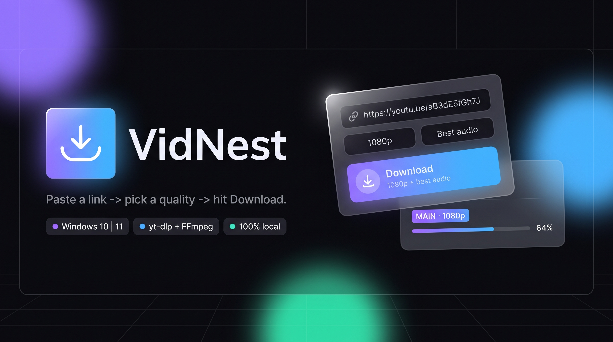

# VidNest

**A tiny, local, no-nonsense media downloader that lives in your browser.**

Paste a link → pick a quality → hit **Download**. That's it.

[](#requirements)
[](#requirements)
[](#how-its-built)
[](#credits)
[](#privacy--security)
[](#license)
[](#built-with-ai)

<br>

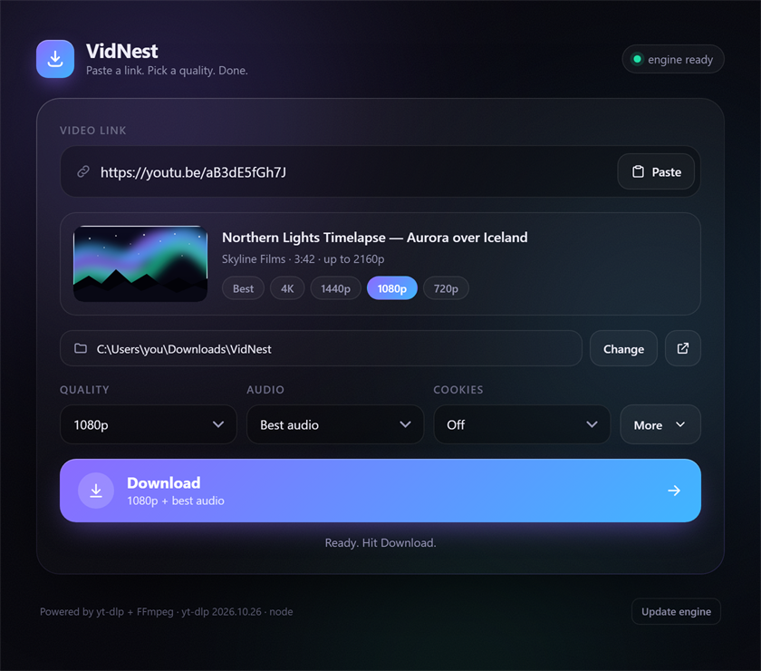

<br>

**[Quick start](#quick-start)** ·
**[Using VidNest](#using-vidnest)** ·
**[Cookies](#cookies-the-one-thing-that-needs-a-minute)** ·
**[Features](#every-feature-explained)** ·
**[Troubleshooting](#troubleshooting)** ·
**[Privacy](#privacy--security)**

</div>

---

## Why

Downloading a video should not require an account, an installer, a browser extension or a mystery
`.exe` from a random website. VidNest is a small Python server that serves one small web page on
`127.0.0.1`, and it drives **yt-dlp** + **FFmpeg** — the same tools everyone already trusts.

| | |
|---|---|
| 🟣 **One button** | The two dropdowns decide what happens. No tabs, no "mode" to forget. |
| 🎞️ **No re-encoding** | Video and audio are muxed, not re-compressed, so quality is untouched. |
| 🔒 **Nothing leaves your PC** | No analytics, no accounts, no cloud. The server only listens on `127.0.0.1`. |
| 📦 **Zero install pain** | No `pip install`, no npm, no build step. `install.bat` fetches what's missing. |
| 🧰 **Real-world options** | Subtitles, playlists, clips, speed limit, SponsorBlock, skip-already-downloaded. |

---

## How it works

<div align="center">
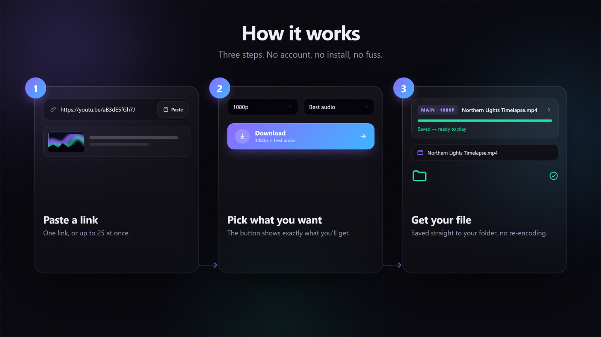
</div>

1. **Paste** a link (or several — up to 25 at a time).
2. **Pick** a *Quality* and an *Audio* option. The button previews exactly what you'll get.
3. **Download.** Jobs run one after another and the finished file appears in your folder.

---

## Requirements

VidNest only runs on **Windows 10 or 11 (64-bit)**. It needs **Python**; everything else is handled
for you.

| What | Needed? | Why | Who installs it |
|---|---|---|---|
| **Windows 10 / 11 (64-bit)** | Required | The launcher and the folder picker are Windows-only. | You already have it. |
| **Python 3.9 or newer** | Required | Runs the local server. No extra packages, no `pip install`. | **`install.bat`** |
| **Node.js 20 LTS or newer** | Recommended | Lets yt-dlp solve YouTube's player challenges, which unlocks the full format list (4K, AV1, HDR…) and avoids most "confirm you're not a bot" errors. | **`install.bat`** (optional step) |
| **yt-dlp** | Auto | Does the actual downloading. | VidNest downloads it into `bin\` on first launch |
| **FFmpeg + ffprobe** | Auto | Merges video + audio and converts audio formats. | VidNest downloads it into `bin\` on first launch |

> Nothing needs to be installed globally. `bin\`, `history\` and `config.json` are created next to
> the app and ignored by git.

---

## Quick start

### 1. Get the files

```bat
git clone https://github.com/0xmicho/VidNest.git
cd VidNest
```

No git? Use **Code → Download ZIP** on GitHub and extract it anywhere (Desktop is fine).

### 2. Install the prerequisites

Double-click **`install.bat`**. It checks what's missing and installs only that:

- **Python 3.13** — required. Uses `winget` when available, otherwise downloads the official
  installer from python.org and runs it silently (no admin needed).
- **Node.js LTS** — recommended, offered with a `Y/N` prompt. Uses `winget`, or drops a single
  `node.exe` into `bin\` when `winget` isn't there.

Nothing is touched if it's already installed, and no reboot is required. Prefer to do it yourself?
See [Manual install](#manual-install).

### 3. Start it

Double-click **`start.bat`**.

- A console window opens and your browser lands on **http://127.0.0.1:8765/**.
- **Keep the console open** while you use it — closing it stops the server.
- On the very first run it also downloads `yt-dlp.exe` and `ffmpeg.exe` into `bin\`
  (about 350 MB unpacked, one time only). The footer shows **`engine ready`** when it's done.

> 💡 Right-click `start.bat` → **Send to → Desktop (create shortcut)** to keep it handy.

---

## Using VidNest

1. **Paste a link** — `Ctrl+V` or the **Paste** button. Several links at once is fine; they queue
   up and download one after another (up to 25).
2. **Check the folder** — **Change** opens the real Windows folder picker and remembers your
   choice. Default: `%USERPROFILE%\Downloads\VidNest`.
3. **Pick a Quality and an Audio**, then press **Download**.

### The one button

There is only one Download button, and the two dropdowns decide what it does:

| Quality | Audio | Result |
|---|---|---|
| `Best available`, `2160p`, `1440p`, `1080p`, `720p`, `480p`, `360p` | `Best audio` | Video **+** sound muxed into one file. `.mp4` when the codecs allow it, otherwise `.mkv`. |
| any video quality | `No audio — video only` | The video with **no sound track** at all. |
| `No video — audio only` | `M4A` · `MP3` · `Opus` · `FLAC` · `WAV` | An **audio-only** file, with cover art where the format supports it. |

So *"360p with the best audio"* is simply:

> **Quality:** `360p` → **Audio:** `Best audio` → **Download**

The button changes colour and subtitle to show what you're about to get **before** you click it:

<div align="center">
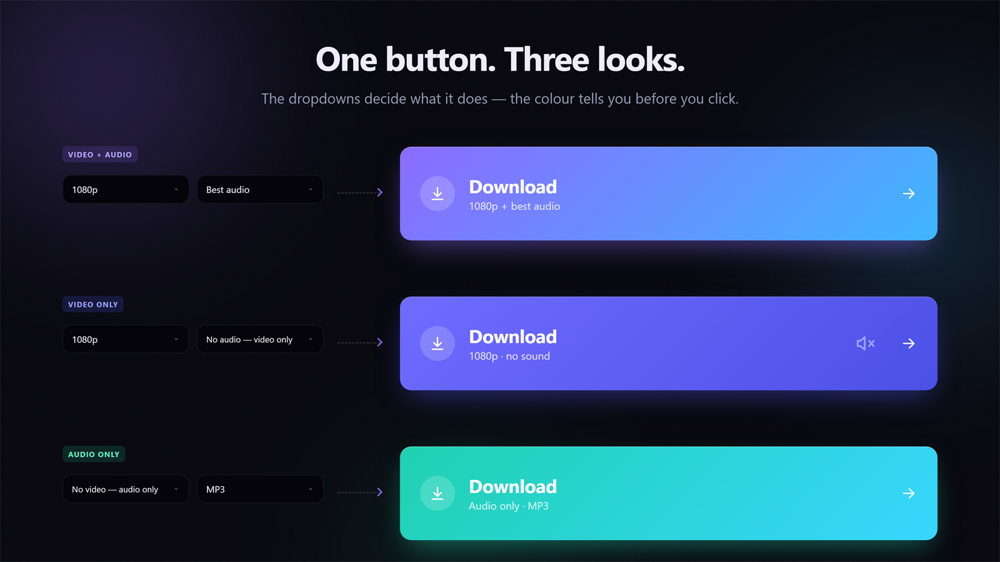
</div>

| Button look | `data-kind` | Meaning |
|---|---|---|
| Violet → blue | `merge` | video + audio (merged) |
| Indigo | `silent` | video only, no sound |
| Teal → cyan | `audio` | audio only |

The **Audio** dropdown rebuilds itself, so impossible combinations can't happen: while a video
quality is selected it only offers `Best audio` / `No audio — video only`; when Quality is
`No video — audio only` it switches to the format list.

<div align="center">
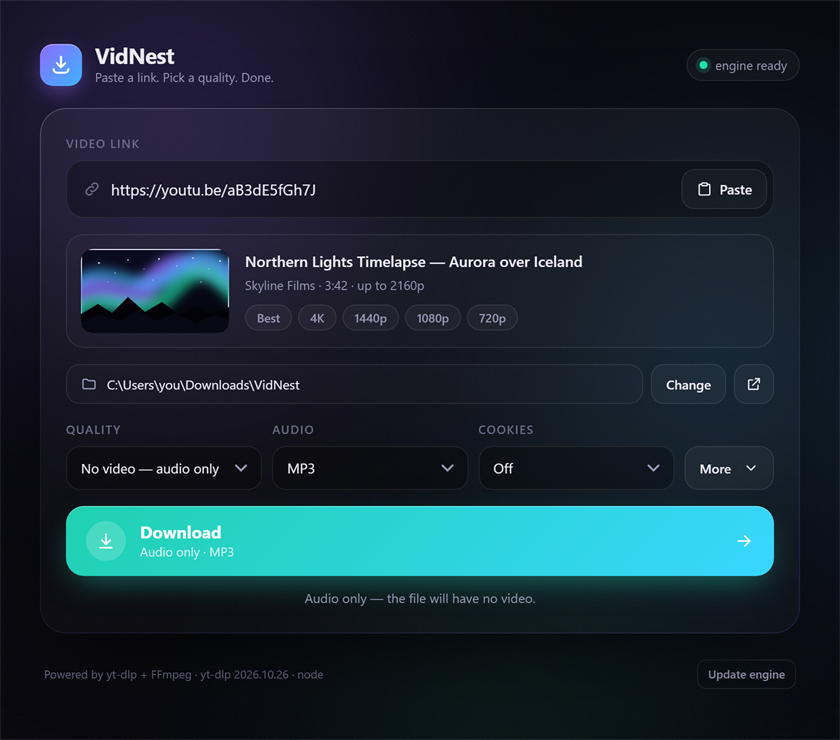
</div>

### Preview card

When the link box holds exactly one link, VidNest shows a card with the thumbnail, channel,
duration and the resolutions that actually exist for that video. Click **Best**, **4K**, `1440p`,
`1080p`, `720p`… to jump straight to that quality — the Quality dropdown follows.

### Keyboard

| Key | Does |
|---|---|
| `Enter` in the link box | Download |
| `Esc` in the link box | Clear it |
| `Tab` / `Space` | Everything is reachable and clickable without a mouse |

---

## Cookies (the one thing that needs a minute)

Cookies are what let YouTube know it's **you**. You only need them for age-restricted videos,
members-only videos, private videos you own, or when you keep getting
*"Sign in to confirm you're not a bot"*. For ordinary public videos, leave Cookies on `Off`.

VidNest has **two** cookie sources, and the first one exists so you **never have to close your
browser** — or the tab VidNest is running in.

### Option A — `cookies.txt` file (recommended, browser stays open) ✅

<div align="center">
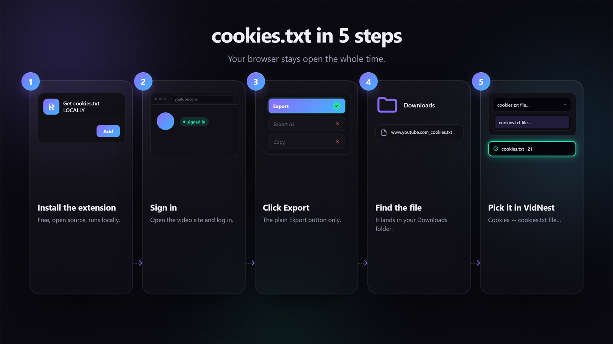
</div>

1. Install **[Get cookies.txt LOCALLY](https://chromewebstore.google.com/detail/get-cookiestxt-locally/cclelndahbckbenkjhflpdbgdldlbecc)**.
   Free, open source, runs entirely in your browser, uploads nothing.
   (Firefox: [addons.mozilla.org](https://addons.mozilla.org/firefox/addon/get-cookies-txt-locally/))
2. Open **https://www.youtube.com** and make sure you are **signed in**.
3. Click the extension icon, then click **Export**.

   > ⚠️ Click **Export** — the plain button. **Not** "Export As", **not** "Copy", **not** "Export
   > JSON". Only **Export** gives VidNest a file it can read.

4. The file is saved to **Downloads**, usually `www.youtube.com_cookies.txt`.
5. In VidNest, open the **Cookies** dropdown → **`cookies.txt file…`** → pick that file.

That's it. The dropdown then shows `cookies.txt · 21`, and every download (and the preview) uses
it. **Your browser can stay open, and VidNest can stay in the tab it's running in.** The choice is
remembered for next time.

<div align="center">
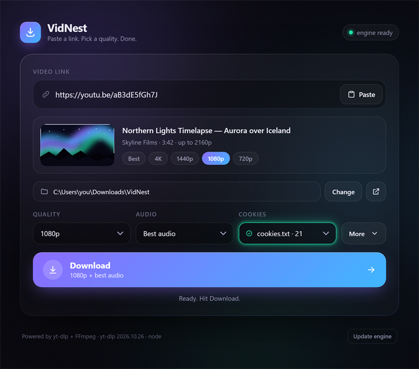
</div>

Cookies expire after a while. If the bot message comes back, just **Export** again and pick the new
file — no restart needed.

### Option B — a browser profile

Pick `Edge` / `Chrome` / `Firefox` / `Brave` / `Opera` / `Vivaldi` in the Cookies dropdown and
yt-dlp reads that browser's own cookie database.

**The catch:** Edge, Chrome, Brave, Opera and Vivaldi lock their cookie file while they run, so
yt-dlp can't copy it. And since VidNest runs *in a browser tab*, closing that browser would close
the tool too. Workarounds:

- **Two browsers** — keep VidNest open in browser **A**, and pick browser **B** in the dropdown.
  Close only **B** (tray icon too). B must be installed and signed into YouTube.
  *Example: you browse in Edge → install Brave, sign into YouTube there, close Brave, choose `Brave`.*
- **Firefox** — its cookie database is usually readable while Firefox is open, so the lock problem
  often doesn't happen.
- **Or just use Option A** — that's what it's for.

### If cookies still fail

| What you see | Fix |
|---|---|
| *… is running and its cookie file is locked* | Close that browser completely (tray icon too), or switch to `cookies.txt file…`. |
| *That cookies file can't be used* | You used *Export As*, *Copy* or *Export JSON*. Open youtube.com → extension → **Export**. |
| *N cookies, but no YouTube login* (toast) | Not signed in when you exported — sign in, then **Export** again. |
| *No cookies.txt picked yet* | The file was moved or deleted — pick it again. |
| *Sign in to confirm you're not a bot* comes back | Cookies expired. Export a fresh file and pick it — no restart needed. |

Cookies only prove **who** you are: they can't unlock DRM content or region-locked videos, and they
don't make downloads faster.

---

## Every feature, explained

Click a feature to expand it.

<details>
<summary><b>Quality</b> — cap the resolution, or skip video entirely</summary>

<br>

`Best available` takes the largest video the site offers. Pick a number (`2160p`, `1440p`,
`1080p`, `720p`, `480p`, `360p`) to cap it — if the video doesn't have that resolution, the next
one down is used. `No video — audio only` skips video entirely. The sound is always the best
available audio track.

</details>

<details>
<summary><b>Audio</b> — sound track, or the audio-only format</summary>

<br>

- **With a video quality:** `Best audio` or `No audio — video only`.
- **With `No video — audio only`:** the output format —
  - **M4A** — the original AAC stream, copied without re-encoding (best quality, plays everywhere).
  - **MP3** — converted, most compatible.
  - **Opus** — small files, great quality, modern players.
  - **FLAC** — lossless, large.
  - **WAV** — uncompressed (no cover art).

</details>

<details>
<summary><b>Cookies</b> — age-restricted, members-only and "confirm you're not a bot"</summary>

<br>

See [above](#cookies-the-one-thing-that-needs-a-minute). Two sources: a `cookies.txt` export
(browser stays open) or a browser profile (close that browser first). Applies to downloads **and**
to the preview card.

</details>

<div align="center">
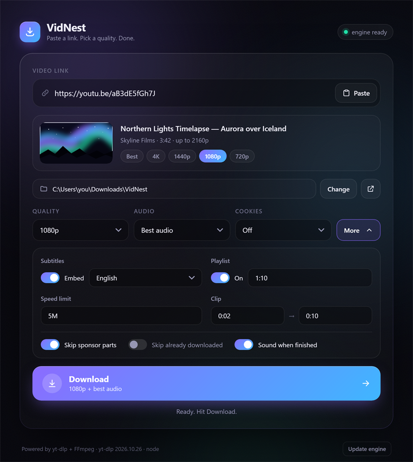
</div>

<details>
<summary><b>Subtitles</b> — embedded into the video file</summary>

<br>

Open **More** → turn on **Subtitles** → pick a language. The subtitles are downloaded and
**embedded** into the video file (auto-generated captions included). Works for video and
video + audio jobs; there are no subtitles in an audio-only file.

</details>

<details>
<summary><b>Playlist</b> — everything, a range, or hand-picked items</summary>

<br>

Open **More** → turn on **Playlist**.

| Items | Downloads |
|---|---|
| *(empty)* | the whole playlist |
| `1:10` | the first ten |
| `1,4,7` | just those |
| `5:` | from the fifth to the end |

Leave it off and a playlist link downloads only the video in the link.

</details>

<details>
<summary><b>Speed limit</b> — be nice to your connection</summary>

<br>

Open **More** → **Speed limit** → type something like `5M` (5 MB/s) or `800K`. Empty means full
speed.

</details>

<details>
<summary><b>Clip</b> — grab just a section</summary>

<br>

Open **More** → **Clip** → `0:02` → `0:10` grabs just that section. Times accept `SS`, `MM:SS` or
`HH:MM:SS`. The range is added to the file name, e.g. `Video [id] [clip 2s-10s].mp4`, so clips
never overwrite the full video.

</details>

<details>
<summary><b>Skip sponsor parts</b> — SponsorBlock</summary>

<br>

Open **More** → turn on **Skip sponsor parts**. Uses SponsorBlock to cut sponsor segments, intros
and outros out of the video.

</details>

<details>
<summary><b>Skip already downloaded</b> — re-run a playlist, fetch only what's new</summary>

<br>

Open **More** → turn on **Skip already downloaded**. VidNest keeps a list per download folder (in
`history\`) and skips anything it already saved, so re-running a playlist only fetches what's new.
The job then finishes with *"Already downloaded — skipped"*.

Clips are deliberately **not** recorded, so you can grab several sections of the same video.

</details>

<details>
<summary><b>Sound when finished</b> — beep + ✓ in the tab title</summary>

<br>

Open **More** → **Sound when finished**. A short beep plus a ✓ in the tab title when a download
completes — handy when you switch tabs.

</details>

### The queue

<div align="center">
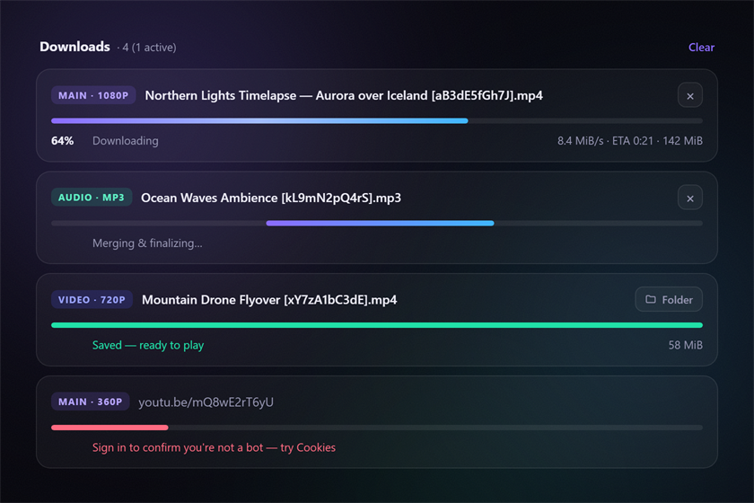
</div>

Every job appears in a list with a badge (`MAIN · 1080p`, `VIDEO · 720p`, `AUDIO · MP3`), live
progress, speed, ETA and size. Jobs run **one at a time**, in the order you queued them.

- **Cancel** stops a queued or running job and cleans up partial files.
- **Open** (on a finished job) reveals the file in Explorer.
- **Clear** removes the finished list (it doesn't delete files).

### Update engine

The footer shows the yt-dlp version. If downloads suddenly start failing, YouTube changed
something — click **Update engine** to fetch the newest yt-dlp build. (Disabled while a download is
running.)

### Remembered settings

Folder, quality, audio format, cookies source and every switch in **More** are saved to
`config.json` and restored on the next launch.

### Works on a small screen too

<div align="center">
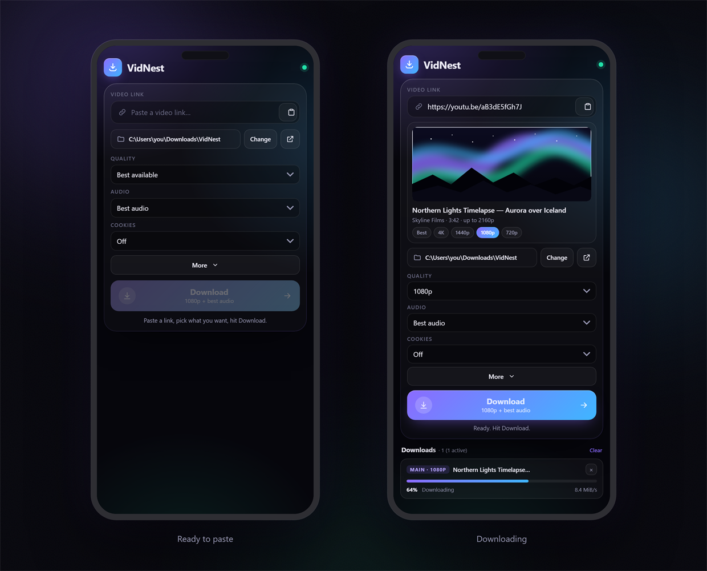
</div>

Under 620 px wide the layout collapses to a single column. Handy if you keep VidNest in a narrow
side-by-side window.

---

## Manual install

Only needed if you'd rather install things yourself.

**Python** — install from [python.org/downloads](https://www.python.org/downloads/windows/).
Tick **"Add python.exe to PATH"** on the first screen, then reopen `start.bat`. Or via a terminal:

```bat
winget install -e --id Python.Python.3.13
```

**Node.js** (recommended) — [nodejs.org](https://nodejs.org/) (LTS), or:

```bat
winget install -e --id OpenJS.NodeJS.LTS
```

Already installed but VidNest still says "Python was not found"? Your `PATH` didn't refresh — log
out and back in, or install again with the "Add to PATH" box ticked. `start.bat` also looks in the
usual install folders, so a normal python.org or winget install works even without a `PATH` entry.

---

## How it's built

<div align="center">
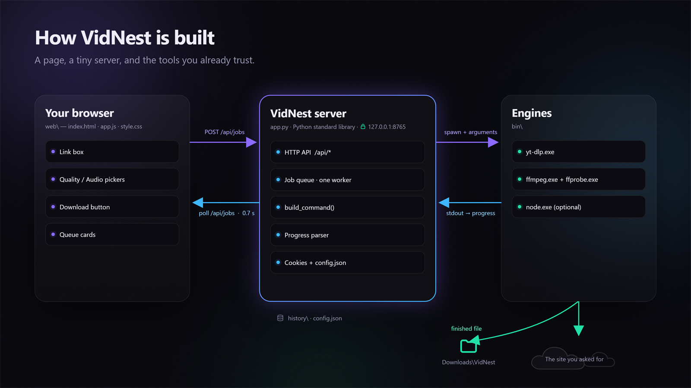
</div>

VidNest is a **single-page web UI wrapped around three command-line tools**. It doesn't implement
downloading, format selection, muxing or conversion itself. It:

1. serves one page on loopback,
2. turns form values into a `yt-dlp.exe` command line,
3. runs that command as a child process,
4. parses the child's stdout into progress numbers,
5. exposes those numbers as JSON,
6. lets the page poll the JSON and paint cards.

| Layer | Where | Role |
|---|---|---|
| **Page** | `web\` | Plain HTML / CSS / JS — no framework, no build step. Polls `/api/jobs` and paints cards. |
| **Server** | `app.py` | Python standard-library `http.server`. Job queue, command builder, progress parser, error translation, cookie handling. |
| **Engines** | `bin\` | `yt-dlp.exe`, `ffmpeg.exe`, `ffprobe.exe`, optional `node.exe`. Spawned with `subprocess`, never linked. |

### Project structure

```
VidNest\
  install.bat     <- installs Python / Node.js (one time)
  start.bat       <- double-click to run
  app.py          <- the local server: queue, yt-dlp commands, progress
  picker.py       <- native "choose folder" / "choose cookies.txt" dialogs
  web\
    index.html    <- the page
    app.js        <- UI logic, queue polling, dynamic pickers
    style.css     <- theme, layout, animations
  docs\           <- images for this README
  bin\            <- yt-dlp.exe, ffmpeg.exe, ffprobe.exe   (auto-downloaded)
  history\        <- skip-already-downloaded lists, one per folder
  config.json     <- your folder + settings + cookies file path
  LICENSE
  README.md
```

`bin\`, `history\` and `config.json` are generated at runtime and excluded by `.gitignore`.

> 📖 Want every function, flag, API route and error message? See
> [`VidNest-Architecture.md`](VidNest-Architecture.md).

---

## Troubleshooting

| Symptom | Fix |
|---|---|
| **"Python was not found"** | Run **`install.bat`**, or install Python from [python.org](https://www.python.org/downloads/windows/) with *"Add python.exe to PATH"* ticked. |
| **Footer says `setting up…` forever** | First run is downloading yt-dlp + FFmpeg. Check your internet, then restart `start.bat`. |
| **"Sign in to confirm you're not a bot"** | Use cookies: export a `cookies.txt` from YouTube (see **Option A**) or pick a browser profile. |
| **"Edge is running and its cookie file is locked"** | Chromium locks its cookie database. Close it completely (tray included), **or** use `cookies.txt file…` instead. |
| **"That cookies file can't be used"** | You probably used *Export As* or *Copy*. Open youtube.com → extension → **Export**. |
| **Cookies worked, now they don't** | They expired. Export a fresh `cookies.txt` and pick it again. |
| **Download fails after working for months** | Click **Update engine** in the footer. |
| **Only low resolutions in the preview** | Install **Node.js LTS** (`install.bat` offers it) so yt-dlp can solve player challenges, then restart. |
| **Port 8765 already in use** | VidNest automatically picks the next free port and prints the URL in the console. |
| **Page says `offline` after a restart** | The server may have moved to a new port. Refresh the tab, or open the URL printed in the console. |
| **Browser doesn't open** | Open **http://127.0.0.1:8765/** manually. |
| **Antivirus flags `yt-dlp.exe`** | It's the official [yt-dlp release](https://github.com/yt-dlp/yt-dlp/releases); add an exclusion or run **Update engine** to re-download it. |

---

## FAQ

<details>
<summary><b>Does it work on macOS or Linux?</b></summary>

<br>

No. The launcher (`.bat`), the native folder picker and the cancel logic (`taskkill`) are
Windows-only by design.

</details>

<details>
<summary><b>Can it download several videos at the same time?</b></summary>

<br>

No — jobs run strictly one after another. That keeps FFmpeg from running in parallel and keeps the
"skip already downloaded" list consistent. Paste up to 25 links and let the queue work.

</details>

<details>
<summary><b>Is my queue saved if I close the window?</b></summary>

<br>

No. The queue lives in memory and disappears when the console closes. Your **settings** are kept
(`config.json`), and with **Skip already downloaded** turned on you can simply run the same links
again.

</details>

<details>
<summary><b>Does it work with sites other than YouTube?</b></summary>

<br>

VidNest hands your link to yt-dlp, so it can work with other sites yt-dlp supports. The cookies
helper and the preview card are built around YouTube.

</details>

<details>
<summary><b>Can it download DRM-protected or region-locked videos?</b></summary>

<br>

No. DRM circumvention and region spoofing are out of scope by design.

</details>

---

## Privacy & security

<div align="center">
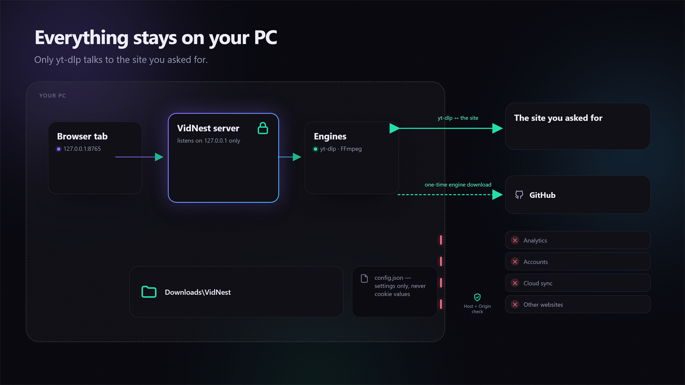
</div>

- The server binds to **127.0.0.1 only** — it is not reachable from your network or the internet.
- `/api/*` rejects foreign `Host` and `Origin` headers, so a random website can't drive your
  downloader (DNS-rebinding protection).
- **No telemetry, no accounts, no cloud.** The only network traffic is yt-dlp talking to the site
  you asked for, plus the one-time engine download from GitHub. (The one remote image on the page is
  the preview thumbnail, fetched by your browser with no referrer.)
- Cookies are read locally for the length of one download. VidNest stores only the **browser name**
  or the **path** to your `cookies.txt` — never the cookie values.
- Text fields can't inject flags: the playlist range and speed limit are whitelisted, clip times are
  re-formatted, and no command is ever run through a shell.
- ⚠️ A `cookies.txt` is **plain text**. Keep it private, don't upload it, and delete it when you're
  done.
- No Python packages are required; everything is the standard library.

---

## Known limits

- Downloads are sequential (one worker).
- The queue and job history are in memory and reset on restart.
- Two VidNest instances share `config.json` and `history\` and can race on writes.
- An interrupted engine download starts over (no resume).
- Progress is polled (about every 0.7 s while busy), not pushed.

---

## Contributing

Issues and pull requests are welcome. Please keep changes **small, Windows-friendly and
dependency-free** — no frameworks, no build step, no `pip install`.

---

## Credits

**Powered by [yt-dlp](https://github.com/yt-dlp/yt-dlp) + [FFmpeg](https://ffmpeg.org/).**

VidNest invents nothing new. It is a thin, friendly wrapper: a small local server that builds
`yt-dlp` commands correctly, and a single page that shows what they're doing. All the actual
downloading, format selection, muxing and converting is done by yt-dlp and FFmpeg — please support
those projects.

- [yt-dlp](https://github.com/yt-dlp/yt-dlp) — downloading and format selection
- [FFmpeg](https://ffmpeg.org/) — muxing and audio conversion
- [SponsorBlock](https://sponsor.ajay.app/) — segment data
- [Node.js](https://nodejs.org/) — JavaScript runtime for yt-dlp's player-challenge solving
- [Get cookies.txt LOCALLY](https://chromewebstore.google.com/detail/get-cookiestxt-locally/cclelndahbckbenkjhflpdbgdldlbecc) — cookie export, done locally

### Built with AI

The code in this repository was written with the help of an AI coding agent, then reviewed and
tested by hand on real downloads. It's scripts, not a research project — and it says so.

---

## Author

**0xmicho** — [@0xmicho](https://github.com/0xmicho)

---

## License

[MIT](LICENSE) © 2026 0xmicho — free to use, modify, and share.

---

## Disclaimer

VidNest is a local front-end for yt-dlp. **You** are responsible for what you download and for
respecting the terms of service and copyright laws that apply to you. Only download content you
own, that is public domain, that is licensed for reuse, or that you otherwise have permission to
save. 

**Ethical & Religious Disclaimer:** 
Please use this tool for beneficial and permissible purposes only (such as educational videos, tutorials, etc.). The author strictly prohibits the use of this tool for downloading any inappropriate or religiously forbidden content (such as music). By using this tool, you acknowledge that you bear full responsibility for your actions before God, and the author clears his responsibility entirely from any sinful or prohibited use.
